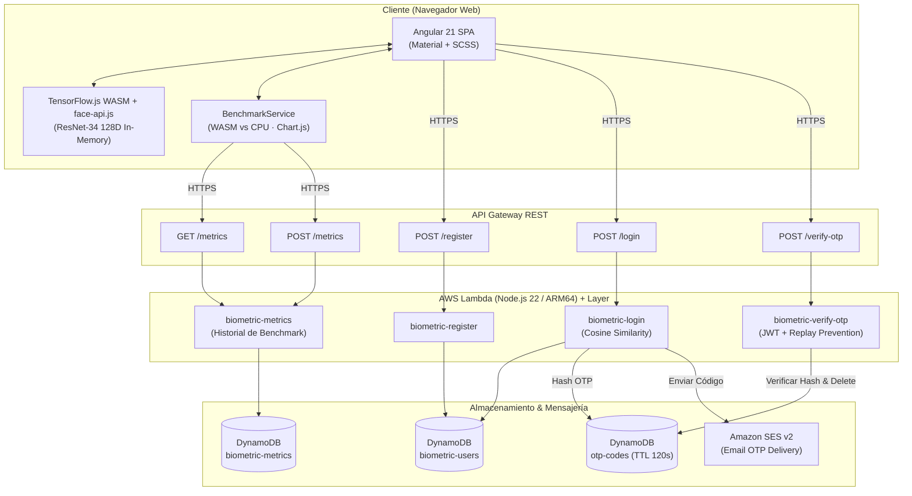
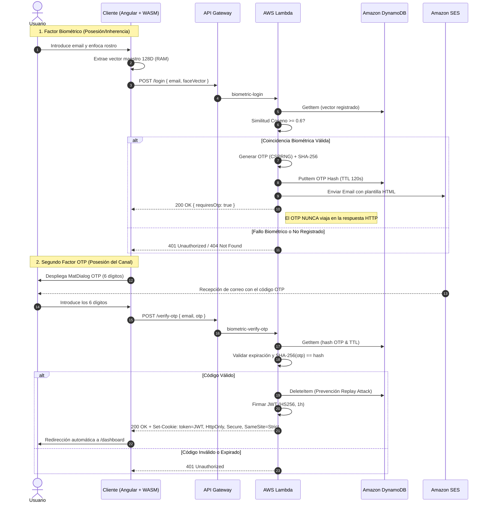

# 🛡️ Biometric MFA Financial Application

[](https://angular.dev/)
[](https://nodejs.org/)
[](https://www.terraform.io/)
[](https://aws.amazon.com/)
[](https://webassembly.org/)
[](https://www.chartjs.org/)

Aplicación web financiera que implementa un sistema de **Autenticación Multifactor (MFA)** combinando **Biometría Facial en cliente** (acelerada por hardware vía WebAssembly) con **Códigos OTP (One-Time Password)** gestionados por un backend serverless en AWS y entrega mediante **Amazon SES**.

---

## 📑 Tabla de Contenidos

- [Características Principales](#-características-principales)
- [Arquitectura del Sistema](#-arquitectura-del-sistema)
- [Flujo de Autenticación MFA](#-flujo-de-autenticación-mfa)
- [Stack Tecnológico](#-stack-tecnológico)
- [Estructura del Proyecto](#-estructura-del-proyecto)
- [Fundamento Matemático (Similitud Coseno)](#-fundamento-matemático-similitud-coseno)
- [Dashboard de Métricas y Benchmark](#-dashboard-de-métricas-y-benchmark)
- [Guía de Puesta en Marcha en Local](#-guía-de-puesta-en-marcha-en-local)
  - [1. Requisitos Previos](#1-requisitos-previos)
  - [2. Levantar Entorno AWS Local (Floci)](#2-levantar-entorno-aws-local-floci)
  - [3. Desplegar Infraestructura (Terraform)](#3-desplegar-infraestructura-terraform)
  - [4. Ejecutar Frontend (Angular)](#4-ejecutar-frontend-angular)
- [Batería de Tests y Validación](#-batería-de-tests-y-validación)
- [Consideraciones de Seguridad](#-consideraciones-de-seguridad)

---

## 🚀 Características Principales

* **Privacidad Biométrica por Diseño**: El vídeo o las fotografías capturadas por la cámara **nunca salen del navegador**. La red neuronal extrae un vector descriptor de 128 dimensiones estrictamente en la memoria RAM (Float32Array) y nunca se persiste en almacenamiento local (`localStorage`, `IndexedDB`).
* **Aceleración por Hardware (WASM)**: Motor biométrico impulsado por `@tensorflow/tfjs-backend-wasm` y redes profundas SSD MobileNet v1 + ResNet-34 para una inferencia facial en tiempo real en milisegundos.
* **Backend Serverless de Confianza Cero**: Las Lambdas en Node.js 22 comparan matemáticamente los vectores biométricos mediante distancia/similitud coseno.
* **MFA con OTP Criptográficamente Seguro**: Generación mediante CSPRNG (`node:crypto`), almacenamiento exclusivo del hash SHA-256 en Amazon DynamoDB y entrega asíncrona mediante **Amazon SES v2**.
* **Protección contra Replay Attacks**: Eliminación atómica (`DeleteItem`) del registro OTP inmediatamente después de su primer uso exitoso.
* **Expiración Automática Nativa (TTL)**: Los códigos OTP caducan automáticamente a los 2 minutos (120 s) en DynamoDB.
* **Gestión de Sesión Blindada**: Emisión de tokens JWT securizados en cookies con atributos `HttpOnly`, `Secure` y `SameSite=Strict`.
* **Dashboard Financiero Temático Oscuro**: Panel de control con desglose de balance, distribución de activos, transacciones recientes y gráfico de curva de rendimiento anual.
* **Dashboard de Métricas y Benchmark**: Página `/metrics` con KPIs en tiempo real (latencia E2E, aceleración WASM vs CPU, tasa de detección, prevención de replay), benchmarking comparativo de backends TF.js y gráficos interactivos generados con **Chart.js** (histograma de similitud coseno, curva ROC, latencia de endpoints HTTP, evolución histórica). Las métricas se persisten en DynamoDB (`biometric-metrics`) vía un endpoint dedicado `GET/POST /metrics`.

---

## 🏗 Arquitectura del Sistema



---

## 🔄 Flujo de Autenticación MFA



---

## 🛠 Stack Tecnológico

| Capa | Tecnología | Descripción |
| :--- | :--- | :--- |
| **Frontend** | Angular 21 | Arquitectura Standalone, Signals, Router Guards, Reactive Forms |
| **Diseño UI** | Angular Material + SCSS | Tema oscuro financiero, layouts glassmorphism, responsive |
| **Biometría** | TensorFlow.js WASM + face-api.js | SSD MobileNet v1, Landmarks 68 y ResNet-34 (descriptores 128D) |
| **Visualización** | Chart.js | Histograma de similitudes, curva ROC, latencia E2E, gráfico WASM vs CPU |
| **Backend** | AWS Lambda (Node.js 22, ARM64) | 4 funciones serverless modulares con soporte ESM (`.mjs`): `register`, `login`, `verify-otp`, `metrics` |
| **Lambda Layer** | `biometric-dependencies` | Capa compartida con dependencias de producción (`jsonwebtoken`) |
| **API** | Amazon API Gateway (REST) | Proxy integrations, endpoints regionales y soporte CORS preflight |
| **Base de Datos** | Amazon DynamoDB | 3 tablas On-Demand: `biometric-users`, `otp-codes` (TTL 120 s) y `biometric-metrics` |
| **Mensajería** | Amazon SES v2 | Envío transaccional de OTP en formato HTML responsivo + texto |
| **IaC** | Terraform (AWS Provider ~> 5.0) | Infraestructura declarativa reproducible y parametrizada |
| **Emulación Local** | Floci (Docker) | Emulador local ligero de DynamoDB, Lambda, API Gateway y SES |

---

## 📁 Estructura del Proyecto

```text
biometric-app/
├── backend/                        # Código del backend Serverless
│   ├── layer/                      # Lambda Layer
│   │   └── nodejs/                 # Dependencias compartidas (jsonwebtoken)
│   ├── src/
│   │   ├── handlers/               # Funciones Lambda
│   │   │   ├── login.mjs           # Login biométrico + cálculo coseno + envío OTP
│   │   │   ├── metrics.mjs         # GET/POST historial de métricas de benchmark
│   │   │   ├── register.mjs        # Registro de usuarios y vectores maestros
│   │   │   └── verify-otp.mjs      # Validación OTP + Replay prevention + emisión JWT
│   │   └── lib/                    # Utilidades y lógica de dominio
│   │       ├── cosine-similarity.mjs # Motor matemático de comparación vectorial
│   │       ├── db.mjs              # Cliente DynamoDB y respuestas CORS
│   │       ├── email.mjs           # Integración con Amazon SES v2
│   │       ├── jwt.mjs             # Firma, verificación de tokens y cookies
│   │       └── otp.mjs             # CSPRNG, hash SHA-256 y TTL
│   └── tests/                      # Suite de tests unitarios con Jest
├── infrastructure/                 # Definiciones de Infraestructura como Código (IaC)
│   ├── api-gateway.tf              # Recursos REST, métodos, integraciones y CORS
│   ├── dynamodb.tf                 # Tablas biometric-users, otp-codes (TTL) y biometric-metrics
│   ├── lambda.tf                   # 4 Funciones Lambda, Layer, Roles y Políticas IAM
│   ├── main.tf                     # Configuración de proveedores Terraform y Floci
│   ├── outputs.tf                  # Salidas (URL de invocación, nombres de tablas)
│   ├── ses.tf                      # Identidad de remitente SES
│   ├── terraform.tfvars.example    # Plantilla de variables de configuración
│   └── variables.tf                # Declaración de variables del entorno
├── public/                         # Assets estáticos
│   ├── models/                     # Pesos de las redes neuronales de face-api.js
│   └── wasm/                       # Binarios WebAssembly de TensorFlow.js
├── src/                            # Aplicación Frontend Angular 21
│   ├── app/
│   │   ├── components/
│   │   │   ├── camera-capture/     # Capturador de cámara, canvas y extracción RAM
│   │   │   └── otp-dialog/         # Modal de 6 casillas OTP reactivo con auto-focus
│   │   ├── guards/                 # Guards funcionales de autenticación
│   │   ├── models/
│   │   │   └── benchmark-result.interface.ts  # Interfaces tipadas de métricas (8 interfaces)
│   │   ├── pages/
│   │   │   ├── dashboard/          # Dashboard financiero oscuro con analítica
│   │   │   ├── login/              # Pantalla de acceso biométrico
│   │   │   ├── metrics/            # Dashboard de métricas y benchmark WASM vs CPU
│   │   │   └── register/           # Pantalla de registro de usuario
│   │   └── services/
│   │       ├── benchmark.service.ts  # Orquesta benchmark, KPIs, Chart.js y persistencia
│   │       └── ...                   # FaceRecognition, Auth, Session
│   └── environments/               # Variables de entorno (dev / prod)
├── compose.yaml                    # Docker Compose para emulación local con Floci
└── README.md
```

---

## 🧮 Fundamento Matemático (Similitud Coseno)

Para validar si el rostro presentado en el inicio de sesión coincide con el registrado originalmente, el backend calcula la **Similitud Coseno ($S_C$)** entre el vector maestro $\mathbf{A}$ (almacenado en DynamoDB) y el vector de verificación $\mathbf{B}$ (enviado por el cliente), ambos en $\mathbb{R}^{128}$:

$$S_C(\mathbf{A}, \mathbf{B}) = \frac{\mathbf{A} \cdot \mathbf{B}}{\|\mathbf{A}\| \|\mathbf{B}\|} = \frac{\sum_{i=1}^{128} A_i B_i}{\sqrt{\sum_{i=1}^{128} A_i^2} \sqrt{\sum_{i=1}^{128} B_i^2}}$$

* **Rango**: $[-1, 1]$, donde $1.0$ representa vectores colineales idénticos.
* **Umbral de Decisión**: Se define un umbral por defecto de **$S_C \ge 0.8$** como coincidencia biométrica positiva segura, tolerando variaciones menores de iluminación, ángulo y expresión facial.

---

## 📊 Dashboard de Métricas y Benchmark

Accesible desde la ruta **`/metrics`**, esta página permite ejecutar un benchmark completo del sistema directamente desde el navegador y visualizar los resultados con gráficos interactivos.

### KPIs principales

| KPI | Descripción |
| :--- | :--- |
| **Aceleración WASM** | Factor de velocidad de WASM frente a CPU puro (ej: `3.9×`) |
| **Tiempo de inferencia** | Media de latencia de inferencia facial (ms) |
| **Latencia E2E MFA** | Tiempo total del flujo login + verify-otp (ms) |
| **Tasa de detección** | % de rostros detectados correctamente en las iteraciones |
| **Anti-Replay Rate** | % de intentos de replay bloqueados (`DeleteItem` atómico) |
| **Umbral de similitud** | Valor de $S_C$ configurado (por defecto `0.80`) |

### Gráficos generados (Chart.js)

* **Histograma de similitudes**: distribución de $S_C$ para vectores genuinos e impostores.
* **Curva ROC**: relación TPR vs FPR en umbrales de decisión de `0.50` a `1.00`.
* **Latencia por endpoint**: comparativa de `POST /register`, `POST /login`, `POST /login (impostor)` y `POST /verify-otp`.
* **WASM vs CPU**: gráfico de barras comparando tiempos de inferencia entre ambos backends.
* **Evolución histórica**: tendencia de latencia E2E a lo largo de las iteraciones del benchmark.

### Persistencia de métricas

Tras cada ejecución, el `BenchmarkService` persiste las métricas clave en la tabla DynamoDB `biometric-metrics` mediante `POST /metrics`. El historial de las últimas 25 ejecuciones es recuperable vía `GET /metrics` para análisis longitudinal.

---

## 💻 Guía de Puesta en Marcha en Local

### 1. Requisitos Previos

* [Docker Desktop](https://www.docker.com/) o daemon de Docker en ejecución.
* [Terraform](https://www.terraform.io/) (versión `>= 1.0`).
* [Node.js](https://nodejs.org/) (versión recomendada `>= 22.x` o `>= 20.x`).
* [npm](https://www.npmjs.com/).

---

### 2. Levantar Entorno AWS Local (Floci)

Inicia el contenedor de **Floci**, que emula DynamoDB, Lambda, API Gateway y SES en el puerto local `4566`:

```bash
docker compose up -d
```

Verifica que el contenedor esté corriendo con `docker compose ps`.

---

### 3. Desplegar Infraestructura (Terraform)

1. Dirígete a la carpeta `infrastructure`:
   ```bash
   cd infrastructure
   ```

2. Crea tu archivo `terraform.tfvars` a partir del ejemplo:
   ```bash
   cp terraform.tfvars.example terraform.tfvars
   ```

3. Asegúrate de que en `main.tf` el bloque de `endpoints` para Floci esté activo (descomentado):
   ```hcl
   provider "aws" {
     region = var.aws_region

     endpoints {
       dynamodb   = "http://localhost:4566"
       lambda     = "http://localhost:4566"
       apigateway = "http://localhost:4566"
       ses        = "http://localhost:4566"
       iam        = "http://localhost:4566"
     }

     access_key                  = "test"
     secret_key                  = "test"
     skip_credentials_validation = true
     skip_metadata_api_check     = true
     skip_requesting_account_id  = true
   }
   ```

4. Inicializa y aplica la infraestructura:
   ```bash
   terraform init
   terraform apply -auto-approve
   ```

---

### 4. Ejecutar Frontend (Angular)

1. Vuelve a la raíz del proyecto e instala dependencias si es la primera vez:
   ```bash
   cd ..
   npm install
   ```

2. Arranca el servidor de desarrollo:
   ```bash
   npm start
   ```

3. Abre tu navegador en **`http://localhost:4200`**.

> **💡 Consejo**: Al iniciar sesión, el código OTP generado por AWS Lambda no se envía a internet sino que se captura localmente en el mailbox de Floci. Puedes inspeccionarlo en los logs del contenedor de Floci (`docker logs -f <container_id>`) o en el buzón local de Floci en `http://localhost:4566`.

---

## 🧪 Batería de Tests y Validación

### Tests Unitarios del Backend (37 tests · 4 suites)

Ejecuta la suite de pruebas unitarias sobre el motor matemático, utilidades criptográficas, gestión de tokens y el handler de métricas:

```bash
cd backend
npm test
```

Resultados cubiertos:
* ✅ **Similitud Coseno** (10 tests): Casos idénticos ($1.0$), ortogonales ($0.0$), opuestos ($-1.0$), vectores de 128D con ruido y validación de tipos/longitud.
* ✅ **Módulo OTP** (10 tests): Generación de 6 dígitos numéricos (CSPRNG), no determinismo, hashing determinista SHA-256 y expiración Unix.
* ✅ **Módulo JWT** (10 tests): Estructura canónica de 3 partes, cálculo de expiración (1 hora), verificación de firma y headers seguros de cookies (`HttpOnly`, `Secure`, `SameSite=Strict`).
* ✅ **Handler `/metrics`** (7 tests): `GET` con historial ordenado por timestamp, `POST` de persistencia de métricas, manejo de errores de DynamoDB (500), JSON inválido (400) y respuestas CORS correctas.

### Verificación de Tipos Frontend

```bash
npx tsc --noEmit
```

---

## 🔒 Consideraciones de Seguridad

1. **Privacidad de Datos**: No se transmiten ni guardan imágenes de rostros en ningún servidor o base de datos.
2. **Cero OTPs en Respuestas HTTP**: La respuesta del endpoint `/login` solo indica `{ "requiresOtp": true }`. El valor del OTP viaja exclusivamente a través del canal fuera de banda (email vía SES).
3. **No-Almacenamiento de Secretos en Claro**: Los OTPs se almacenan en DynamoDB bajo formato de resumen criptográfico SHA-256.
4. **Prevención de Ataques de Repetición**: Cada OTP se destruye de la base de datos al momento de ser canjeado con éxito.
5. **Mitigación CSRF y XSS**: Los JWTs se gestionan como cookies de sesión con flags `HttpOnly` y `SameSite=Strict`.

